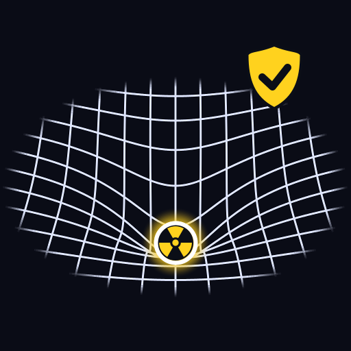

<p align="center"></p>

<h1 align="center">NTM Claims</h1>

<p align="center">Makes <a href="https://github.com/Warfactory-Official/NTM-Continuum">NTM - Continuum</a> respect <a href="https://www.curseforge.com/minecraft/mc-mods/ftb-chunks-forge">FTB Chunks</a> claims: no more nukes, missiles or fallout wiping out claimed bases.<br>Minecraft 1.21.1 · NeoForge · server-side</p>

---

## Features

NTM uses its own explosion system, so FTB Chunks never sees it. NTM - Continuum asks a protection API before it changes the world, and this mod answers that API with your claims.

- **Explosions** (bombs, missiles, nukes, shrapnel) are blocked in claims, unless the team has **Allow Explosions** turned on. This applies even to your own nuke.
- **Radiation and fallout**, **fire**, **fluids** (acid, lava, gases), **terraforming** and **block placement** by NTM effects are blocked in claims.
- **Hazards from other players** (radiation, gas, fire, blasts) are blocked where the claim has **PvP disabled**.
- **Trusted players**: machines and small effects from team members and allies keep working, and admins in bypass mode are always trusted.
- **LC FTB Hook**: paid regions follow their bought explosion protection.
- **No mixins, no duplication**: protected blocks are skipped before NTM touches them.
- **Fast**: claims are checked once per chunk, not once per block.

Blocks outside claims behave as normal. A nuke next to a claim still levels the area around it and stops at the claim border.

## Configuration

`config/ntmclaims-common.toml`:
- turn each category on or off (`explosions`, `fire`, `fluids`, `radiation`, `terraform`, `placement`);
- choose who is trusted (`trust.*`);
- apply the claim's PvP setting (`pvp.respectClaimPvp`);
- log every decision (`debug.logDecisions`).

`/ntmclaims check` (OP) tells you whether an NTM explosion would be blocked where you stand.

## Requirements

- **NTM - Continuum** and **Golem Core**
- **FTB Chunks**, with FTB Library, FTB Teams and Architectury

Install on the **server**. Clients don't need it.

## Building

Standard NeoForge [ModDevGradle](https://github.com/neoforged/ModDevGradle) project. Requires JDK 21.

```sh
./gradlew build        # jar in build/libs/
```

Dependencies come from CurseForge through [CurseMaven](https://www.cursemaven.com/). GitHub Actions builds every push, and pushing a tag `v<mod_version>` publishes a release.

## License

[MIT](LICENSE). Unofficial add-on, not affiliated with the NTM - Continuum team or FTB. Thanks to HbMinecraft and the HBM's Nuclear Tech Mod team, Warfactory (NTM - Continuum) and FTB.
